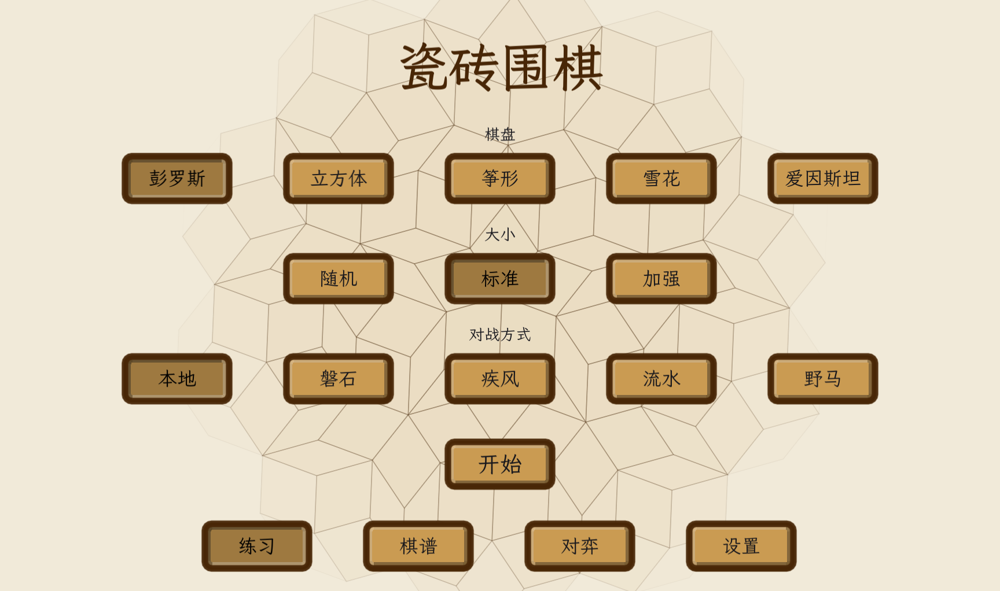
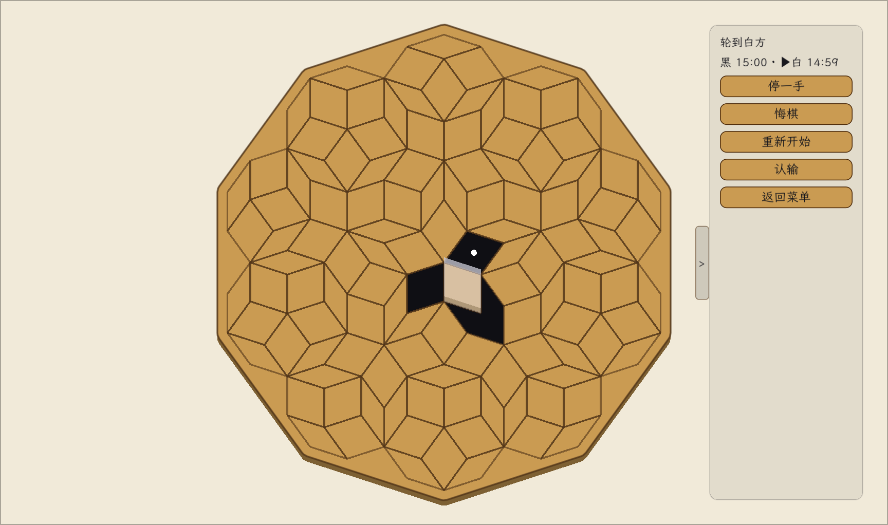

# Tile Go

[中文](README.md) | English

**Go, played on aperiodic tilings.** No corners. No edges. Every cell has a different number of neighbours.

Single-player vs. AI · Windows · free · MIT. ~57k lines of GDScript (Godot 4.7).





---

## Download & play

Grab `TileGo-windows-x64.zip` from [Releases](../../releases), unzip, run `TileGo.exe`.

- Windows 10/11 x64, no engine install required
- Saves live in `%APPDATA%/Godot/app_userdata/瓷砖围棋/`

### What this build deliberately leaves out

| Removed | Why |
|---|---|
| Online multiplayer | Needs the Steam SDK, accounts, and lobby services |
| Game records / replay | Full-version feature, unrelated to playing a game |
| Theme switching | One "classic" palette (rice-paper white) only |

What's left: **board + rules + AI**. The full version (12 themes, records, Steam online play) ships with the Steam release.

## The boards

| Board | Underlying structure |
|---|---|
| Penrose | Penrose P3 rhombus tiling, generated by Robinson triangle substitution |
| Cube | Every 3 rhombi form a regular hexagon; hexagons tile into a honeycomb |
| Kite | Every 3 kites (obtuse tips together) form an equilateral triangle; triangles tile |
| Snowflake | Ammann–Beenker tiling (octagrid dual); 8 rhombi meet acutely at the centre |
| Einstein | The hat / turtle / spectre — aperiodic *mono*tiles from a substitution system |

Each board comes in three sizes: Random (generated per game, ~200 cells) / Standard (~120 cells) / Large (~360 cells).

Rules are ordinary Go: liberties, groups, capture, ko, superko, area scoring. Adjacency is defined by **shared edges**, so liberties take triangular, quadrilateral and pentagonal shapes — every bit of shape intuition you have from a square board is void here.

Four opponents:

| Name | What it is |
|---|---|
| 磐石 (Rock) | Main engine — MCTS + heuristic evaluation (3 difficulty levels) |
| 疾风 (Gale) | A more aggressive variant |
| 流水 (Current) | A different search structure, kept for cross-checking |
| 野马 (Mustang) | Neural-network evaluation (self-trained weights in `ai/yema_weights.json`) |

---

## 🎯 Come build this AI

This is the main reason the game is open source.

Its strength is roughly amateur level, and I know exactly where it plateaus — I've already hit the walls, and the data is all in this repo. Everything you need is here:

| What you want | Where |
|---|---|
| Main engine | `ai_engine.gd` (~5200 lines): MCTS + heuristic eval + tactical rollouts |
| Every knob | The `@export` block at the top of the same file — all adjustable at runtime |
| Variant engines | `ai_engine_liushui.gd` / `ai_engine_yema.gd` |
| Neural-net groundwork | `nn_score.gd` + `ai/yema_weights.json` + `ai/yema_golden.json` |
| Self-play / A-B harness | `--aispec` / `--aiprof` / `--aibud` in `game.gd` |

### Run an experiment in five minutes

```bash
# Two engine variants play 16 games (colours auto-swapped), differing by one parameter
godot --headless --path . -- --aispec=r16:pw100:a=count_prisoners=false:b=count_prisoners=true
```

`a=` and `b=` each hold a set of `name=value` overrides (comma-separated); colons separate tokens. You get win rate, score margin and time ratio. Reproducible (seeded) and paired (same opening, colours swapped) — no manual board setup.

### Dead ends, already marked for you

These are measured results. **Don't spend time here:**

- **Compute is saturated.** Doubling the time budget (200ms → 400ms, 1.64× the cost) gave **16:16 over 32 games**. Same for adding threads (53.1%, z = 0.35).
- **The "influence" term is load-bearing.** Remove it and win rate collapses to **15.6%** (80.6% single-threaded / 84.4% at production settings, two independent seed batches agreed). Leave it alone.
- **Dead-stone gating, capture bonuses, full-board scanning** — all tested, all noise (capture term over 56 games: z = −0.27). The defaults are already optimal.
- **Evaluation radius** (influence spread distance): all four directions tested. 7 is optimal; narrowing or widening both hurt.

What's actually left is **the shape of the evaluation function** — not compute, not noise, not search width.

### Directions I'd love to see

1. **Change the search form.** On a 120-cell board, MCTS may simply be the wrong answer — I have an old observation that it loses to a 90ms greedy player. Prove it and this repo deserves a rewrite.
2. **Learned priors.** The existing `yema` weights are self-trained and have never beaten the hand-tuned heuristic. The problem may be the *metric* (val loss as a proxy for playing strength — the two can point in opposite directions), not the model.
3. **Better endgame evaluation.** Current area-scoring is naive.
4. **Anything that makes the evaluation understand tiling shape.** That's where this game actually gets interesting.

### One thing to read before you report a result

**16 games is not enough.** The 95% CI for an 8-game colour-swapped match is roughly **[38%, 82%]** — you will see "68.8%, big win", and the next batch drops to 43.8%.

**To claim a result: at least three independent seed batches, |z| ≥ 3, score margin agreeing in sign.**

---

## Build from source

Requires **Godot 4.7.2** (GL Compatibility; no C#, no build step).

```bash
git clone https://github.com/Xiran-D/Tilingo.git
cd Tilingo
godot --path .
```

Main scene is `menu.tscn`; jump straight into a game with `godot --path . res://game.tscn`.

The repo ships **no Steam SDK** (`addons/godotsteam/`, `steam_api64.dll` are gitignored). `steam_net.gd` talks to Steam purely via reflection, so a missing plugin just makes `is_available()` return false and the game runs normally — the lite build doesn't show online entries anyway.

## Cutting a release

Pushing a tag triggers GitHub Actions, which exports and attaches the build:

```bash
git tag v0.8.0 && git push origin v0.8.0
```

Local export (needs 4.7.2 export templates installed in the editor first):

```bash
godot --headless --path . --export-release "Windows Desktop (Lite)" dist/TileGo.exe
```

The `Windows Desktop (Lite)` preset carries `custom_features="lite"` — that is the single switch for the slim build (see the `lite` field in `game_config.gd`).

## Layout

```
game.gd                 Gameplay: rendering / placement / animation / self-tests
rules_kernel.gd         Rules kernel: liberties / groups / capture / superko / scoring
ai_engine.gd            Main AI (MCTS + heuristics)  ★ start here to improve the AI
ai_engine_liushui.gd    "Current" variant
ai_engine_yema.gd       "Mustang" (learned evaluation)
nn_score.gd             NN forward pass and features
menu.gd                 Main menu (hand-drawn tile layout)
game_config.gd          All tunables and saves (incl. the lite switch)
music.gd                Procedural music synthesis (no audio files, generated live)
themes/                 Theme .tres files (lite build uses 00_宣纸 only)
art/font/               LXGW WenKai subsets (OFL 1.1)
ai/                     Mustang weights and golden baselines
```

## Known limitations

- Windows preset only; Linux/macOS need their own export preset
- The AI is amateur strength — no dan-level ambitions
- Portrait/mobile layout is on hold

## License

Code is MIT — see [LICENSE](LICENSE).

Bundled font **LXGW WenKai**: SIL Open Font License 1.1, see `art/font/README.md`.

**Godot Engine** 4.7.2: MIT.
